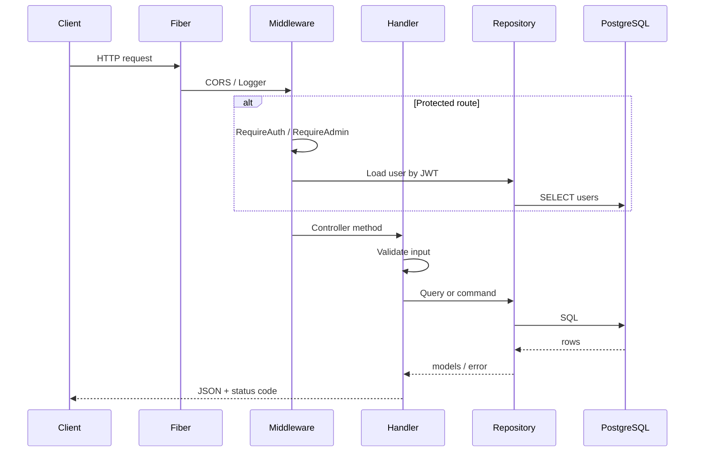

# Sopify Backend — Request Flow & Architecture

Backend-only guide for how an HTTP request moves through the Go API.

**Stack:** Fiber v3 · PostgreSQL · JWT · Stripe

---

## Layered design

```
HTTP Request
    │
    ▼
┌─────────────┐
│ Middleware  │  CORS, logging, auth (JWT)
└──────┬──────┘
       ▼
┌─────────────┐
│ Controller  │  Parse request, validate input, HTTP status + JSON
│ (handlers)  │
└──────┬──────┘
       ▼
┌─────────────┐
│  Service    │  Business rules (cart stock, checkout, webhook logic)
│ (optional)  │
└──────┬──────┘
       ▼
┌─────────────┐
│ Repository  │  SQL only — no HTTP, no business rules
└──────┬──────┘
       ▼
┌─────────────┐
│  Database   │  PostgreSQL
└─────────────┘
```

| Layer | Folder | Responsibility |
|-------|--------|----------------|
| **Entry** | `cmd/api/main.go` | Wire config, DB, deps, routes, start server |
| **Middleware** | `internal/middleware/` | Cross-cutting: CORS, logger, JWT auth, admin check |
| **Controller** | `internal/handlers/` | HTTP in/out: bind body, call service/repo, return JSON |
| **Service** | `internal/services/` | Business logic (see note below) |
| **Repository** | `internal/repository/` | Database queries |
| **Model** | `internal/models/` | Structs + JSON tags |
| **Config / infra** | `internal/config/`, `internal/database/`, `internal/auth/`, `internal/storage/` | Env, Postgres, JWT, file uploads |

### Sopify today

This repo uses **Controller → Repository** directly for most features. There is **no `internal/services` package yet** — business rules live inside handlers (e.g. stock checks in `cart.go`, webhook fulfillment in `stripe_webhook.go`).

For teaching, think of the pattern as:

```
Request → Controller (handler) → Service (logic in handler today) → Repository → DB
```

As the app grows, extract a service layer (e.g. `CartService`, `OrderService`) and keep handlers thin.

---

## Request lifecycle



---

## Middleware chain

Applied in `cmd/api/main.go` before routes:

| Order | Middleware | Purpose |
|-------|------------|---------|
| 1 | Logger | Request logging (skips `/health`) |
| 2 | CORS | Allow `http://localhost:3000` |
| 3 | Static `/uploads` | Product images |

Per-route middleware (in `routes.go`):

| Middleware | Routes |
|------------|--------|
| `RequireAuth` | `/me`, `/cart`, `/checkout`, `/orders`, `/auth/logout` |
| `RequireAdmin` | `/admin/*` |

**Auth flow:** `Authorization: Bearer <token>` → verify JWT → load user → token must match `users.token`.

---

## Example flows

### 1. Public read — `GET /products`

```
Client
  → Fiber route (routes.go)
  → ProductHandler.ProductList          [controller]
  → ProductRepository.ListProducts      [repository]
  → PostgreSQL
  ← []Product JSON
```

**Files:** `handlers/products.go` → `repository/product.go`

---

### 2. Protected write — `POST /cart`

```
Client + Bearer token
  → RequireAuth                         [middleware]
  → CartHandler.AddItem                 [controller]
      · parse { product_id, quantity }
      · validate qty > 0
      · ProductRepository.GetProductByID
      · check stock                       [business — in handler today]
      · CartRepository.UpsertItem
      · build CartResponse
  → PostgreSQL
  ← CartResponse JSON
```

**Files:** `middleware/auth.go` → `handlers/cart.go` → `repository/cart.go`, `repository/product.go`

---

### 3. Admin — `POST /admin/products` (multipart)

```
Client + admin token
  → RequireAuth → RequireAdmin
  → ProductHandler.CreateProduct        [controller]
      · parse form + optional image
      · validate price, stock, category [business — product_form.go]
      · LocalStorage.Save (if image)    [storage]
      · ProductRepository.Create
  → PostgreSQL + uploads/
  ← Product JSON
```

**Files:** `handlers/products.go`, `handlers/product_form.go` → `storage/local.go` → `repository/product.go`

---

### 4. Stripe webhook — `POST /webhooks/stripe`

```
Stripe
  → StripeWebhookHandler.Handle         [controller]
      · verify Stripe-Signature
      · on checkout.session.completed:
          · idempotency check (order by session id)
          · read cart                       [repository]
          · create order + items            [repository]
          · decrement stock                 [repository]
          · clear cart                      [repository]
  → PostgreSQL
  ← 200 OK
```

**Files:** `handlers/stripe_webhook.go` → `repository/order.go`, `repository/cart.go`, `repository/product.go`

No JWT middleware — authenticated by Stripe signing secret.

---

## Project map

```
backend/
├── cmd/api/main.go              # Bootstrap + graceful shutdown
├── internal/
│   ├── config/                  # .env
│   ├── database/                # Postgres connect
│   ├── middleware/              # CORS, logger, auth
│   ├── handlers/                # Controllers + routes.go
│   ├── repository/              # Data access
│   ├── models/                  # Domain structs
│   ├── auth/                    # JWT sign/verify
│   └── storage/                 # Local image files
└── migrations/                  # SQL schema
```

---

## Controller ↔ route table

| Method | Route | Controller | Repository(ies) |
|--------|-------|------------|-------------------|
| GET | `/health` | `HealthHandler` | `database` ping |
| GET | `/products` | `ProductHandler` | `ProductRepository` |
| GET | `/categories` | `CategoryHandler` | `CategoryRepository` |
| POST | `/auth/login` | `AuthHandler` | `UserRepository` |
| GET | `/cart` | `CartHandler` | `CartRepository`, `ProductRepository` |
| POST | `/checkout` | `CheckoutHandler` | `CartRepository` |
| POST | `/webhooks/stripe` | `StripeWebhookHandler` | `Order`, `Cart`, `Product` |
| GET | `/orders` | `OrderHandler` | `OrderRepository` |
| POST | `/admin/products` | `ProductHandler` | `ProductRepository`, `CategoryRepository` |

Full route list: `internal/handlers/routes.go`

---

## Rules per layer

### Controller (`handlers`)

- Read path params, query, body
- Return correct HTTP status (`400`, `401`, `403`, `404`, `500`)
- Log unexpected errors
- **Do not** write raw SQL here

### Service (when you add it)

- Stock limits, cart merge rules, checkout snapshots
- Orchestrate multiple repositories in one use case
- No `fiber.Ctx`, no JSON response shaping

### Repository

- SQL only (`QueryContext`, `ExecContext`, transactions)
- Return `models` or sentinel errors (`ErrProductNotFound`)
- **Do not** know about HTTP or JWT

---

## Adding a new endpoint

1. **Model** — struct in `internal/models/`
2. **Repository** — method in `internal/repository/`
3. **Service** (optional) — business method in `internal/services/`
4. **Controller** — handler method in `internal/handlers/`
5. **Route** — register in `handlers/routes.go`
6. **Wire** — inject repo/handler in `cmd/api/main.go`

---

## Related docs

- [backend_plan.md](backend_plan.md) — phased build plan
- [../docs/backend/CHEATSHEET.md](../docs/backend/CHEATSHEET.md) — API + Postman
- [../docs/steps/](../docs/steps/) — step-by-step teaching guide
